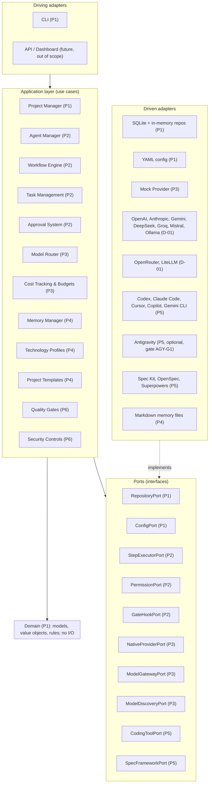
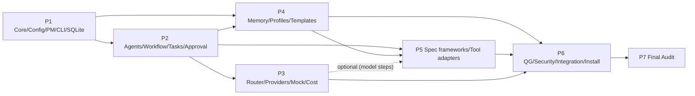

# ARCHITECTURE_PROPOSAL.md — AI Engineering OS (Draft v3)

> الحالة: **مقترح، غير معتمد.** لا مكون ولا تكامل منفَّذ.

## 1. المبادئ
1. **Hexagonal / Ports & Adapters** (ADR-001): النطاق والتطبيق في المركز، وكل ما هو خارجي محول.
2. **CLI-first** (ADR-003): الـ API والـ Dashboard امتدادات مستقبلية تستخدم نفس طبقة التطبيق.
3. **لا مزود إلزامي** (ADR-004)، و**لا تقنية مُرمَّزة في النواة** (ADR-010).
4. **أربعة أنواع تكامل منفصلة** (ADR-009 المعدّل): Native AI Provider · Model Gateway · AI Coding Tool · Spec Framework.
5. **التحقق قبل التنفيذ** (ADR-008): لا محول بلا رابط وثيقة رسمية وتاريخ تحقق.
6. **حد أدنى من البنية التحتية** (ADR-012 المعدّل): Python + SQLite + ملفات. Docker اختياري للتكاملات المستقبلية فقط. لا Kubernetes ولا Kafka ولا Vector DB.

## 2. الطبقات


**قاعدة الاعتماد:** `cli → application → domain`، و `adapters → ports`. لا تستورد طبقة domain أو application أي adapter. يُفرض ذلك باختبار حدود تلقائي (T1.09).

## 3. هيكل المستودع المقترح (لن يُنشأ قبل الموافقة)
```
ai-engineering-os/
  pyproject.toml
  src/<package>/            # ⚠️ اسم الحزمة واسم أمر الـ CLI حسب SPEC
    domain/                 # P1
    application/            # use cases per component
    ports/                  # interfaces (Protocol/ABC)
    adapters/
      persistence/          # sqlite, memory  (P1)
      config/               # yaml            (P1)
      providers/native/     # P3 mock; real adapters per D-01
      providers/gateways/   # per D-01
      coding_tools/         # P5
      spec_frameworks/      # P5
    cli/                    # P1
  profiles/                 # technology profiles (P4, data)
  templates/                # project templates (P4, data)
  tests/unit | contract | integration
  docs/                     # Phase 0 docs + user docs
```

## 4. المكونات: المسؤولية والحدود
| المكون | المرحلة | المسؤولية | يعتمد على | لا يعتمد على (ممنوع) |
|---|---|---|---|---|
| Domain models | 1 | الكيانات والقواعد، بلا I/O | — | أي شيء آخر |
| Configuration | 1 | YAML (safe-load) + تحقق + طبقات | Domain | providers |
| Persistence | 1 | Repository abstraction؛ SQLite و in-memory؛ migrations | Domain | application |
| Project Manager | 1 | دورة حياة المشروع؛ تخزين الـ technology id كمعرف معتم (opaque) حتى P4 | Config, Repo | Memory, Profiles (P4) |
| CLI | 1 | تحليل الأوامر واستدعاء use cases؛ الأوامر غير المتاحة بعد تُعلن مرحلتها | Application | adapters مباشرة |
| Agent Manager | 2 | تعريف الوكلاء (خصائص، صلاحيات، ميزانية) من YAML | Domain, Config, Repo | Router, Cost (P3) |
| Task Management | 2 | المهام وحالاتها | Domain, Repo | Workflow |
| Workflow Engine | 2 | تنفيذ المراحل؛ checkpoints؛ استدعاء StepExecutor و GateHook و PermissionPort | Agent, Task, Approval | Router, providers, QG impl |
| Approval System | 2 | نقاط توقف وموافقة/رفض مع سجل | Repo | Security (P6) |
| Provider Ports + Registry | 3 | عقود Native و Gateway؛ تسجيل؛ إعلان القدرات | Domain | Router |
| Mock Provider | 3 | محول حتمي للاختبار؛ مرجع لاختبارات العقد | Provider ports | — |
| Model Registry + Discovery | 3 | بيانات النماذج + المصدر + التاريخ؛ اكتشاف عند وجود endpoint موثق | Provider ports | Router |
| Model Router | 3 | اختيار نموذج حسب المعايير والمستويات والسياسة؛ fallback؛ ينفذ StepExecutor للخطوات النموذجية | Registry, Cost (قراءة الميزانية) | Workflow internals |
| Cost Tracking & Budgets | 3 | تسجيل الاستهلاك (عبر أحداث) وفرض ميزانيات الوكيل/المهمة/المشروع | Repo | Router (لا اعتماد عكسي) |
| Memory Manager | 4 | Markdown (قابل للقراءة) + فهرس SQLite | Repo, Project | Agents |
| Technology Profiles | 4 | بيانات YAML: أوامر build/test/lint، قواعد | Config | Code-level tech logic |
| Project Templates | 4 | إنشاء مشروع من قالب | Project, Profiles | — |
| Spec Framework adapters | 5 | تكامل Spec Kit و OpenSpec و Superpowers بعد التحقق | SpecFrameworkPort, Workflow, Templates | providers |
| AI Tool adapters | 5 | تشغيل الأدوات أو توليد تعليماتها حسب الواجهة الموثقة؛ إعلان مستوى القدرة | CodingToolPort, Workflow | providers |
| Antigravity adapter | 5 | **اختياري**، بشرط AGY-G1 | CodingToolPort | — |
| Quality Gates | 6 | تنفيذ GateHook بفحوص من Profiles | Profiles, Workflow hook | — |
| Security Controls | 6 | تنفيذ PermissionPort بسياسات كاملة، إدارة الأسرار، تدقيق | Agent permissions, Approval | — |

## 5. تصنيف التكاملات
| النوع | التعريف | الأمثلة | المنفذ |
|---|---|---|---|
| Native AI Provider | API المزود الأصلي، باتصال مباشر | OpenAI، Anthropic، Gemini، DeepSeek، Groq، Mistral، Ollama | NativeProviderPort |
| Model Gateway | وسيط يوحّد الوصول لعدة مزودين | OpenRouter، LiteLLM | ModelGatewayPort |
| AI Coding Tool | أداة برمجة مستقلة تنفذ مهام | Codex، Claude Code، Cursor، Copilot، Gemini CLI، Antigravity | CodingToolPort |
| Spec Framework | إطار منهجي للمواصفات وسير العمل | Spec Kit، OpenSpec، Superpowers | SpecFrameworkPort |

- **الاتصال المباشر (PRV-020)** يبقى ممكنًا دائمًا؛ الـ Gateway اختياري ولا يكون نقطة فشل وحيدة.
- **LiteLLM:** يحتاج التحقق إن كان سيُستخدم كمكتبة أم كخادم proxy. الاستخدام كخادم proxy يعني بنية تحتية إضافية تخالف TC-007، لذا الافتراض المقترح هو وضع المكتبة الاختياري (قرار D-05).
- **التوافق مع OpenAI** لا يعني تطابق الميزات: كل محول يعلن قدراته ويختبرها.

## 6. الاكتشاف الديناميكي وبيانات النماذج
- `ModelDiscoveryPort` يُنفَّذ فقط للمحولات التي لها endpoint قائمة نماذج موثق رسميًا.
- السجل اليدوي (YAML) إلزامي الحقول: `source_url`، `verified_at`، `pricing_source`، `tier` (⚠️ القيم حسب SPEC)، و `class` (free/paid/local).
- الأسعار لا تُرمَّز في الكود أبدًا.

## 7. Antigravity: بوابة AGY-G1
الأدلة المتوفرة حتى الآن: وثائق مرفقة محليًا مع Antigravity تذكر Python SDK (`google-antigravity`) و CLI `agy` و MCP/Skills/Hooks. هذا **ليس تحققًا كافيًا**. شروط البوابة:
1. رابط وثيقة رسمية حية للواجهة المستخدمة.
2. شروط الاستخدام تسمح بالتكامل الآلي.
3. تجربة قراءة فقط ناجحة تُجرى بموافقتك.
4. النظام يجتاز كل اختباراته بغياب Antigravity.

إن لم تتحقق الشروط، يُسجَّل AGY-001 `Deferred`.

## 8. مراجعة الاعتماديات


| # | التعارض المكتشف | الحل المقترح (دون نقل تنفيذ بين المراحل) | يحتاج موافقة؟ |
|---|---|---|---|
| C-01 | ميزانية الوكيل (P2) ↔ Cost (P3) | P2 تعريف الحقل والتحقق منه فقط؛ الفرض في P3 | نعم (D-03) |
| C-02 | Workflow (P2) يحتاج نماذج (P3) | `StepExecutorPort` في P2؛ اختبارات P2 تستخدم test doubles داخل `tests/` (ليست Mock Provider)؛ الـ Router ينفذه في P3 | نعم (D-03) |
| C-03 | Approval (P2) ↔ Security (P6) | Approval آلية مستقلة؛ Security تضيف سياسات تستدعيها | لا (لا نقل) |
| C-04 | صلاحيات الوكيل (P2) ↔ Security (P6) | `PermissionPort` في P2 بتنفيذ افتراضي deny-by-default للعمليات الخطرة + موافقة يدوية؛ التنفيذ الكامل في P6 | نعم (D-03) |
| C-05 | مراحل Workflow ببوابات (P2) ↔ QG (P6) | `GateHookPort` في P2؛ الحالة الافتراضية `not evaluated` | نعم (D-03) |
| C-06 | المحولات الحقيقية للمزودين غير مذكورة في أي مرحلة أصلية (P3 = interfaces + Mock فقط) | **قرار D-01** (الخيارات في DECISIONS) | **نعم: يمس النطاق** |
| C-07 | أسرار المزودين قبل Security (P6) | PRV-005: حد أدنى (env refs + redaction) مع المحولات | نعم (يتبع D-01) |
| C-08 | Project Manager (P1) يشير لتقنية (P4) | تخزين معرف معتم؛ التحقق في P4 | لا |
| C-09 | إنشاء المشروع (P1) ↔ Templates (P4) | P1 ينشئ هيكلًا افتراضيًا أدنى؛ القوالب في P4 | لا |
| C-10 | الذاكرة (P4) ↔ حالة المشروع (P1–P3) | الحالة في SQLite عبر Repository منذ P1؛ Memory يبني عليها | لا |
| C-11 | Router ↔ Cost (خطر دورة اعتماد) | Cost يستقبل أحداث استهلاك ولا يستورد Router؛ Router يقرأ حالة الميزانية فقط | لا |
| C-12 | Agent Manager ↔ Workflow (خطر دورة اعتماد) | Workflow يعتمد على Agent؛ والعكس ممنوع | لا |
| C-13 | Ubuntu Installation (P6) ↔ بيئة التطوير (P1) | P1 توثيق إعداد التطوير فقط؛ التثبيت للمستخدم في P6 | لا |
| C-14 | P5 tools قد تحتاج Router (P3) | ترتيب المراحل يضمن P3 قبل P5؛ لا مشكلة | لا |
| C-15 | الأدوات لا تعيد بيانات الاستهلاك | COST-003 حالة `unknown` | نعم (مقترح) |

**النتيجة:** لا دورات اعتماد بعد تطبيق الحلول. الاعتماد الأمامي الوحيد غير المحلول هو C-06.
